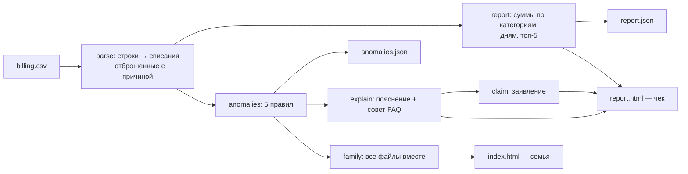

# Как всё устроено — простым языком

## Путь одного файла

1. **parse** читает CSV построчно: каждая физическая строка разбирается отдельно. Строка, которая не подходит, целиком уходит в «отброшенные» с причиной
   и номером строки: пустая → не то число колонок → неизвестный тип → дата не разбирается → плохое число.
   Две даты (`2026-09-12 14:00:00` и `12.09.2026 14:00:00`) и запятая в сумме (`"1,20"`) — нормальные данные.
2. **report** складывает деньги как `Decimal` и округляет только на выходе. Календарь — без пропусков,
   с 1-го числа: день без трат тоже есть, с нулём.
3. **anomalies** — пять независимых правил. Каждое возвращает свои находки, потом всё сортируется по времени.
4. **explain** превращает находку в фразу с числами и подбирает ответ из FAQ оператора (ТЗ 5) на русском и кыргызском.
5. **claim** собирает заявление из спорных строк. Сумма в кнопке и в тексте считаются по одним и тем же позициям.
6. **family** смотрит на все файлы сразу: итоги, короткие номера у нескольких людей, сверка с эталонами.

## Пять правил на примере бабушки (`billing_03.csv`)

| Правило | Что нашли | Переплата |
|---|---|---|
| Ночное платное SMS/контент `[00:00, 06:00)` | 14.09 в 01:37 SMS на 62626 за 10 сом | 10,00 |
| Новая подписка на короткий номер (первая в файле) | 23.09 подписка 53530 за 8 сом; повтор 30.09 — уже не новая | 8,00 |
| Дубль за 60 секунд | 12.09: звонок 16:55:01 за `6.00` и 16:55:54 за `"6,00"` — одно и то же в разных форматах, 53 с | 6,00 |
| Международный звонок дороже 20 сом/мин | 07.09 звонок на +971517547668, 2 мин 3 с за 82 сом = 40 сом/мин | 41,00 (82 − 20·123/60) |
| День дороже обычного, z-score > 3 | 29.09 потрачено 464,95 при среднем 50,42 за предыдущую неделю — в 9,2 раза | 414,53, но в возврат не входит |

«Возможно лишнее» у бабушки — **65,00 сом**: 41 + 6 + 10 + 8. Необычный день не прибавляем: он состоит из тех же списаний.

## Семья (все пять файлов)

| Профиль | Потрачено | Возможно лишнее | Находок |
|---|---|---|---|
| Я | 1 230,16 | 56,00 | 4 |
| Папа | 1 391,32 | 24,59 | 3 |
| Бабушка | 2 106,02 | 65,00 | 5 |
| Мама | 1 638,85 | 46,67 | 5 |
| Брат | 1 919,07 | 12,00 | 3 |
| **Итого** | **8 285,42** | **204,26** | **20** |

**Находка вне правил ТЗ:** короткий номер **7575** списывает за контент у всех пятерых — 7 раз, 85 сом, всегда днём.
Ни одно правило его не ловит: не ночь, не подписка, не дубль. Видно только на семейном экране.
В `anomalies.json` этого нет: автопроверка посчитала бы это ложным срабатыванием.

## Ответы на вопросы жюри

1. **Почему `Decimal`, а не `float`?** Во `float` 0.1 + 0.2 ≠ 0.3. В сумме сотен строк ошибка в копейку сорвала бы сверку с эталоном.
2. **Почему z-score по 7 предыдущим дням?** Так в уточнениях. Окно только назад: в момент списания будущее неизвестно. Нулевые дни считаются, иначе тихая неделя завышала бы среднее. Ряд дней — основной месяц детализации с 1-го числа: одна случайная строка из августа не превратит начало сентября во «всплески».
3. **Почему при `std = 0` бесконечность?** Неделя одинаковых трат и вдруг рост — это и есть всплеск. Деление на ноль обработано явно.
4. **Почему дубли не удаляются из отчёта?** Это два реальных списания: деньги ушли дважды, поэтому их и просим вернуть.
5. **Почему необычный день не входит в «возможно лишнее»?** Он складывается из тех же спорных списаний — сложение посчитало бы деньги дважды.
6. **Как вы нашли 7575, если это не аномалия?** Отдельный анализ коротких номеров по всем файлам семьи. В `anomalies.json` не попадает.
7. **Деньги правда возвращаются?** Нет, мы готовим заявление с точными строками детализации; решение за оператором. Окно телефона — помеченная демонстрация.
8. **Что если в файле неизвестный мусор?** Каждая строка проверяется по пяти причинам, неподходящая уходит в `dropped_rows.csv`. Программа не падает: тесты на CRLF, BOM, пустой файл, картинку вместо CSV.
9. **Как масштабировать на оператора?** Разбор линейный, правила независимы. Репутация коротких номеров по всем абонентам — готовый сигнал для антифрода.
10. **Где ИИ и не выдумает ли он суммы?** ИИ только пишет письмо по уже посчитанным числам. Письмо отбрасывается, если в нём есть число больше 10 не из расчёта (сумма, номер, дата), нет главной суммы, есть обещание вернуть деньги, ссылка или текст не на русском. По умолчанию — бесплатный Gemini или локальная Ollama.
11. **Как вы проверяете, что всё верно?** 162 теста, в том числе точное совпадение всех пяти отчётов и 20 аномалий с эталонами организаторов. Тот же результат показывает штамп на семейном экране и `check.py`.
12. **Что делал каждый в команде?** Распределите заранее и прогоните вслух: `parse` и `report`, `anomalies`, `family` и заявление, интерфейс и демо.
